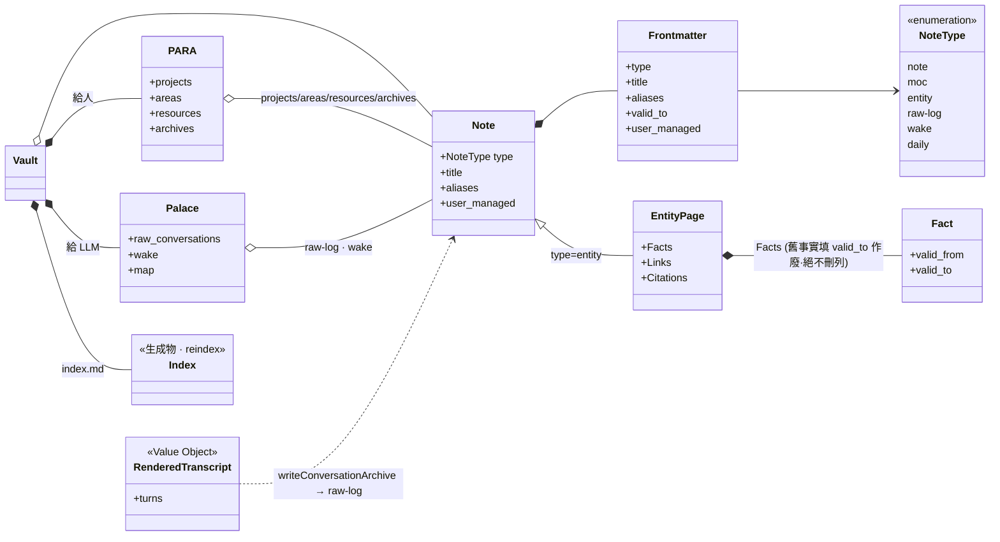
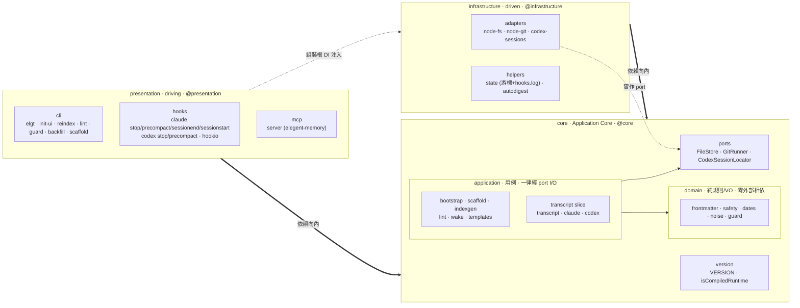
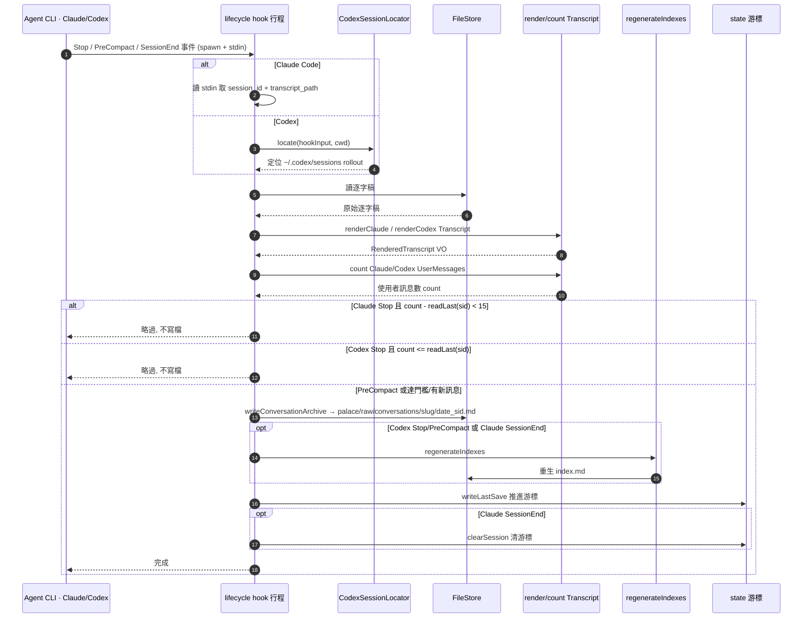
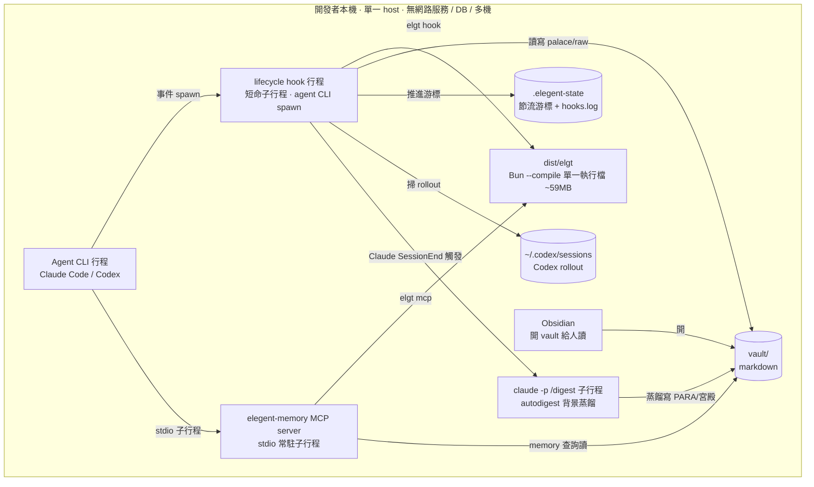
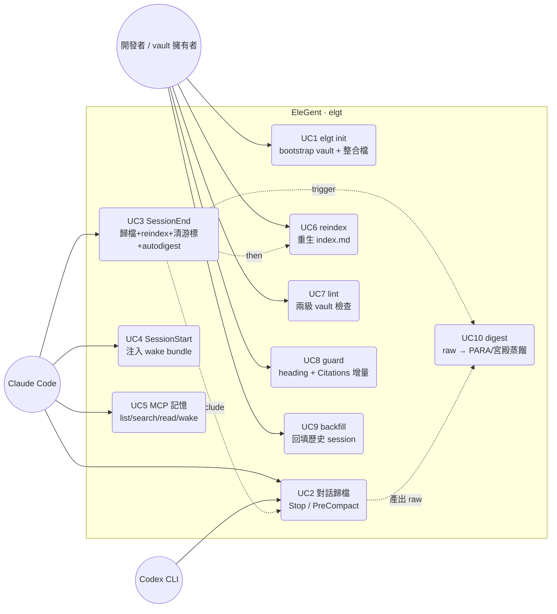

# EleGent 架構文件 — 4+1 視圖模型

> 本文用 Kruchten 的 **4+1 視圖模型**，從四個受眾角度（Logical / Development / Process / Physical）描述 EleGent（`elgt`）CLI，再用 **Scenarios (+1)** 的 use case 把前四個視圖綁在一起並驗證它們。
>
> 所有圖只從固定的「架構共享模型」渲染，不自行增刪元件或改名。決策的「為什麼」不在此文件，請見決策紀錄：[`docs/adr/`](../adr/)。
>
> 一句話定位：EleGent 在使用者資料夾建立**雙受眾 markdown vault**（PARA 給人、記憶宮殿給 LLM），並整合各家 agent CLI 的 lifecycle hooks + MCP，自動把對話逐字稿歸檔進 vault 並對外供記憶查詢。**這個 repo 是「產生 vault 的工具原始碼」，不是活的 vault。**

---

## 1. Logical View（邏輯／領域視圖）

**受眾：** 想理解「這個系統在管什麼資料、有哪些不變式」的人。

領域核心是 **Note**：vault 裡每個非保留 `.md` 都是一個 Note，帶 frontmatter，`type` 限定為 `note | moc | entity | raw-log | wake | daily` 的列舉。Vault 有兩個受眾面向的結構：**PARA**（`projects / areas / resources / archives`，給人）與**記憶宮殿 Palace**（`palace/raw/conversations`、`palace/wake`、`palace/map`，給 LLM）。`index.md` 是 `reindex` 的**生成物**（不手改），導覽在 `palace/map`。

兩個關鍵領域規則：

- **EntityPage**（`type=entity`）有固定槽位 **Facts / Links / Citations**；`Facts` 是時間性事實表，舊事實用 `valid_to` 標記作廢、**絕不刪列**（只增不刪）。
- **RenderedTranscript** 是歸檔用的值物件（Value Object）：由 `renderTurns` 從外部逐字稿解析而成，再經 `writeConversationArchive` 落地為 `palace/raw/conversations` 下的 `raw-log` Note。

---

## 2. Development View（開發／模組分層視圖）

**受眾：** 在這個 repo 寫程式的人。

程式碼是 **Explicit Architecture（Ports & Adapters / Hexagonal）** 三區塊，依賴一律**向內**：`presentation → core ← infrastructure`；跨區塊走 `@core` / `@presentation` / `@infrastructure` 別名。

- **core/**（Application Core，純、不碰 fs/spawn/os）：`domain/`（`frontmatter`、`safety`、`dates`、`noise`、`guard`）、`application/`（`bootstrap`、`scaffold`、`indexgen`、`lint`、`wake`、`templates` + `application/transcript/` slice：`transcript` / `claude` / `codex`）、`ports.ts`（`FileStore` / `GitRunner` / `CodexSessionLocator`）、`version.ts`。
- **presentation/**（driving；組裝根，注入 infrastructure）：`cli/`（`elgt` + `init-ui` + `reindex`/`lint`/`guard`/`backfill`/`scaffold`）、`hooks/`（`claude/*` + `codex/*` + `hookio`）、`mcp/server`。
- **infrastructure/**（driven；被 app 呼叫）：`adapters/`（`node-fs`、`node-git`、`codex-sessions` 實作 core port）、helpers（`state`、`autodigest`）。

**依賴規則（`src/architecture.test.ts` 在 CI 強制，違反即 build fail）：** (1) core 不得 import presentation/infrastructure；(2) infrastructure 不得 import presentation；(3) core 生產碼不得碰 `node:fs` / `node:os` / `Bun.spawn`（I/O 一律經 port）。

---

## 3. Process View（執行期／流程視圖）

**受眾：** 想理解「執行期各行程如何互動、資料怎麼流」的人。

畫最關鍵的 **hook 歸檔流程**。agent CLI 在 `Stop` / `PreCompact` / `SessionEnd` 事件 spawn 短命 hook 行程；**取逐字稿與後續動作因 CLI/事件而異**：Claude 直接從 stdin 拿 `session_id + transcript_path`；Codex 用 `CodexSessionLocator.locate` 掃 `~/.codex/sessions` 的 rollout。Claude Stop 才有 `SAVE_INTERVAL = 15` 節流且不 reindex；Claude PreCompact 無節流、不 reindex；Claude SessionEnd 會歸檔、成功時 reindex、清游標，並可觸發 autodigest。Codex Stop 只在 `count <= lastSave` 時略過，Codex PreCompact 無節流；兩者只要成功寫檔都會 reindex。

---

## 4. Physical View（實體／部署視圖）

**受眾：** 想理解「執行期有哪些 runtime 單元、跑在哪、碰哪些磁碟」的人。

**全部在使用者本機，無網路服務、無 DB、無多機拓撲**——但本機仍有多個值得畫的 runtime 單元：編譯執行檔 `dist/elgt`（Bun `--compile` 單一執行檔，約 59MB）；hook 是 agent CLI 在事件時 spawn 的**短命子行程**；`elegent-memory` MCP server 是 agent CLI 的 **stdio 常駐子行程**；`autodigest` 會背景 spawn `claude -p /digest` 子行程。磁碟上有 `vault/`（markdown）、`.elegent-state`（節流游標 + hooks.log）、以及 codex-sessions adapter 唯一會讀的 `~/.codex/sessions`（Codex rollout）。Obsidian 純讀 vault 給人看。

---

## 5. Scenarios (+1)（場景／use case 視圖）

**受眾：** 想用「誰、為了什麼」把前四個視圖串起來並驗證它們的人。

三個外部 actor 對應到十個關鍵用例：**開發者 / vault 擁有者**（人）跑 `init` 及維運用例（`reindex` / `lint` / `guard` / `backfill`）；**Claude Code** 觸發 lifecycle 用例（`對話歸檔` / `SessionEnd` / `SessionStart`）並連 MCP 查記憶；**Codex CLI** 只觸發歸檔類 hook 用例（Stop/PreCompact）。`SessionEnd`（UC3）只存在於 Claude 路徑：它 include 歸檔（UC2，Process View）、成功歸檔後 `reindex`（UC6，Logical View 的 `index.md` 生成物）、清游標，並可 trigger `autodigest → /digest`（UC10，Physical View 的背景子行程），而 UC10 消化的正是 UC2 產出的 `palace/raw`。（Antigravity `agy` 為規劃中、未實作，不列入。）

---

### 視圖對照速查

| 視圖 | 回答的問題 | 圖型 | 主要元件 |
|---|---|---|---|
| Logical | 系統管什麼資料、有哪些不變式 | classDiagram | Note/NoteType、PARA、Palace、EntityPage(Facts/Links/Citations)、RenderedTranscript |
| Development | 模組怎麼分層、依賴往哪走 | package/flowchart | core(domain/application/ports) · presentation(cli/hooks/mcp) · infrastructure(adapters/helpers) |
| Process | 執行期怎麼跑、資料怎麼流 | sequence | hook 歸檔（Claude/Codex 與 Stop/PreCompact/SessionEnd 差異） |
| Physical | 有哪些 runtime 單元、碰哪些磁碟 | deployment flowchart | dist/elgt · hook 子行程 · MCP stdio 子行程 · vault/.elegent-state/~/.codex/sessions |
| Scenarios (+1) | 誰為了什麼用系統，串起前四視圖 | use-case flowchart | 開發者 / Claude Code / Codex × UC1–UC10 |
