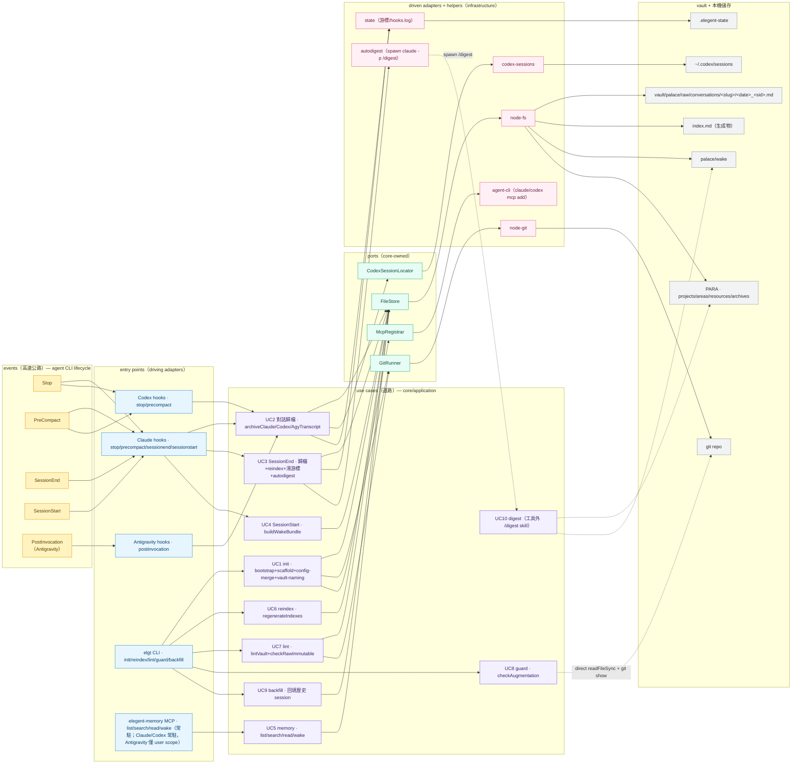

# Application Map — EleGent 行為地圖

> 把系統當一張地圖：**components 是城市**（core / presentation / infrastructure 的主要模組）、**use cases 是道路**（UC1..UC10，把某個 entry point 接到某些 core 用例、再落到某些 port）、**events 是高速公路**（agent CLI 的 lifecycle 事件 Stop / PreCompact / SessionEnd / SessionStart，觸發整條歸檔 / 喚醒流程）。
> 這張地圖只描述**行為**（誰觸發誰、資料流到哪）；**依賴方向**與其 CI 強制見 [dependencies.md](./dependencies.md)。全部在使用者本機，無網路服務。

## 1. 行為地圖（entry point → 用例 → port / adapter → vault）

**讀圖**：由左而右一路 `event（高速公路）→ entry point → use case（道路）→ port → adapter → vault`。實線＝主流程；灰虛線＝ `autodigest` 在 SessionEnd 後**非同步**回頭 spawn 的 `/digest`（工具外 skill，故 UC10 無 port）。箭頭表「觸碰/流向」，讀寫之別見下方對照表（例如 UC4 是**讀** `wake`，UC2/UC3 是**寫** `raw`）。

## 2. 城市 × 道路 × 高速公路對照表（UC1..UC10）

| UC（道路） | 觸發（高速公路 / 手動） | entry point（driving adapter） | core 用例（城市：application/domain） | ports 用到 | adapters / helpers | vault 產物 / 儲存 |
|---|---|---|---|---|---|---|
| **UC1** init | 手動 `elgt init` | `cli/elgt` | `bootstrap` → `scaffold`、`regenerateIndexes`、`renderTemplate`（digest skill）、`mergeClaudeSettings`/`mergeCodexHooks`/`mergeAgyHooks`（config-merge，冪等合併 hooks）、`vaultDirName`/`resolveVaultDir`（vault-naming，local/project 依 basename 強制命名）、`renderCodexMcpToml` | FileStore, GitRunner, McpRegistrar | node-fs, node-git, agent-cli（`claude`/`codex mcp add`） | 建 vault 骨架 + digest skill + hooks 設定（依 scope 落 `.claude/settings(.local).json`／`.codex/hooks.json`／`.agents/hooks.json` 或對應 user dir）+ `index.md`；**不再**產生 `CLAUDE.md`/`AGENTS.md`/`.mcp.json`；MCP 依 scope 走 `claude`/`codex mcp add` 或直寫 `.codex/config.toml`／`mcp_config.json`（agy 僅 user scope）；非 git repo 則 init+commit |
| **UC2** 對話歸檔 | **Stop / PreCompact / PostInvocation** | `hooks/claude/{stop,precompact}`、`hooks/codex/{stop,precompact}`、`hooks/agy/hook`（postinvocation/stop） | `render{Claude,Codex,Agy}Transcript` → `count*UserMessages` → `writeConversationArchive` | FileStore（Codex 另用 CodexSessionLocator 掃 sessions） | node-fs, codex-sessions, state（游標） | 寫 `palace/raw/conversations/<slug>/<date>_<sid>.md`；推進 `.elegent-state` 游標。Claude Stop 門檻是每有 1 則新使用者訊息就寫（`SAVE_INTERVAL=1`，見 `src/infrastructure/state.ts`）且不 reindex；Claude PreCompact 無節流、不 reindex；Codex Stop 只在 `count<=lastSave` 時略過，Codex PreCompact 無節流，兩者寫檔成功都會 reindex；Antigravity postinvocation/stop 目前行為相同，皆用訊息數節流 |
| **UC3** SessionEnd | **SessionEnd** | `hooks/claude/sessionend` | 歸檔（同 UC2）+ `regenerateIndexes`；清游標；觸發 autodigest | FileStore | node-fs, state（清游標）, autodigest | 補寫 raw + 重生 `index.md`；spawn `/digest`（→ UC10） |
| **UC4** SessionStart | **SessionStart** | `hooks/claude/sessionstart` | `buildWakeBundle`（wake） | FileStore | node-fs | **讀** `palace/wake/identity.md` + `palace/wake/essential-story.md`，注入 additionalContext（memory-wake），不寫 |
| **UC5** MCP 記憶 | agent 隨呼隨用（常駐，非事件） | `mcp/server.ts` | `resolveVaultRoots`（主 vault + 自動探測 `{slug}.vault`/`.{slug}.vault`）→ `listDirs/searchVaults/readFromVaults/wakeVaults` 跨所有 root 查詢，結果以 `[vault 標籤]` 標註來源；`memory_wake` 底層仍呼叫 `buildWakeBundle`（core），其餘三個工具直接在 presentation 以 `node:fs` 實作 | FileStore（僅 `memory_wake` 經 `buildWakeBundle`） | node-fs（wake）、presentation `node:fs` helpers（list/search/read，跨 root） | **唯讀**查詢一個或多個 vault（全域 + 專案內嵌） |
| **UC6** reindex | 手動 `elgt reindex` | `cli/reindex` | `regenerateIndexes`（indexgen） | FileStore | node-fs | 重生 `index.md`（生成物） |
| **UC7** lint | 手動 `elgt lint` | `cli/lint` | `lintVault` + `checkRawImmutable` | FileStore, GitRunner | node-fs, node-git | **唯讀**檢查：frontmatter/type/斷鏈/fact 區間 + `palace/raw` append-only（經 git diff） |
| **UC8** guard | 手動 `elgt guard <file>` | `cli/guard` | `checkAugmentation`（domain/guard，純規則） | 無（presentation 直接 `readFileSync` + `Bun.spawnSync(["git", ...])`） | 無 port adapter；直接讀檔與呼叫 git | **唯讀**單檔檢查任意既有檔案是否刪除 heading、減少 Citations，或修改 `user_managed: true` 檔 |
| **UC9** backfill | 手動 `elgt backfill [projectsDir]` | `cli/backfill` | `archiveClaudeTranscript` 回填（application/transcript/claude） | FileStore | node-fs | 補寫 Claude `palace/raw/conversations` 歷史檔；目前不支援 Codex 回填 |
| **UC10** digest | autodigest 於 SessionEnd 後 spawn（工具外） | `claude -p /digest` 子行程（非 elgt） | 無（由 `/digest` skill 執行，工具邊界外） | 無 | autodigest（spawn + lockfile） | **讀** `palace/raw` → **蒸餾寫入** PARA + `palace/wake` |

## 3. 高速公路（events）→ 觸發流程

| event（高速公路） | 觸發 | 說明 |
|---|---|---|
| **Stop** | UC2 對話歸檔 | Claude 從 stdin 拿 `session_id`+`transcript_path`，門檻是每有 1 則新使用者訊息就寫（`SAVE_INTERVAL=1`）且不 reindex；Codex 用 CodexSessionLocator 掃 `~/.codex/sessions`，只有完全沒有新訊息（`count<=lastSave`）才略過，寫檔成功會 reindex |
| **PreCompact** | UC2 對話歸檔 | Claude/Codex 都無節流、壓縮前保存逐字稿；Codex 寫檔成功會 reindex，Claude 不會 |
| **SessionEnd** | UC3（→ 觸發 UC10） | Claude 專用：歸檔 + `regenerateIndexes` + 清游標 + spawn `/digest`（autodigest） |
| **SessionStart** | UC4 | 注入 wake bundle（memory-wake）到 additionalContext |
| **PostInvocation** | UC2 對話歸檔 | Antigravity 專用：每次呼叫後觸發，用訊息數節流（同 Codex Stop 語意）；`stop` 型別已留但目前與 postinvocation 行為相同，且沒有任何設定會實際觸發它 |

> `elgt` 子指令（init / reindex / lint / guard / backfill）是**手動出入口**、非事件驅動；**MCP** 是 Claude/Codex 的**常駐** stdio 子行程（隨呼隨用查詢記憶），Antigravity 沒有對應 CLI，僅 user scope 會把設定直接合併進 `mcp_config.json`——三者都不掛在 lifecycle 高速公路上。
