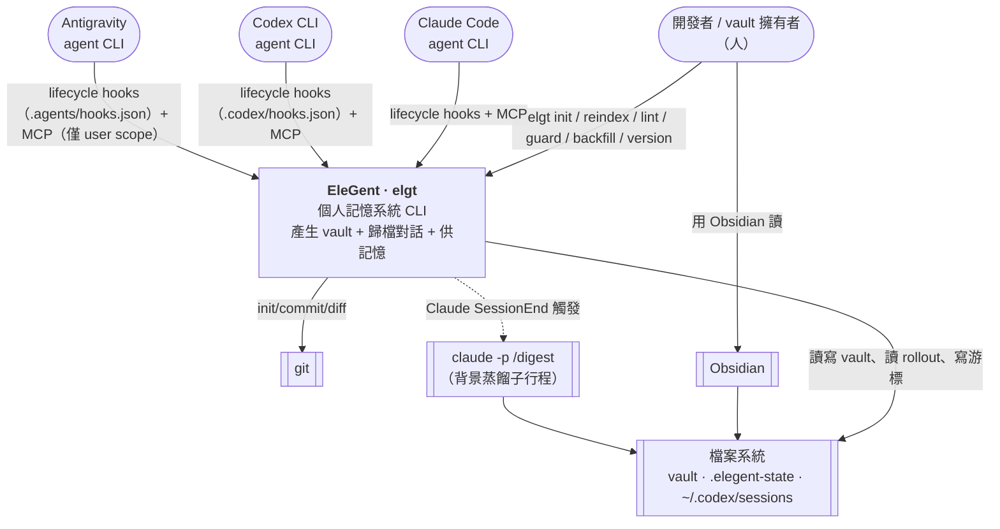
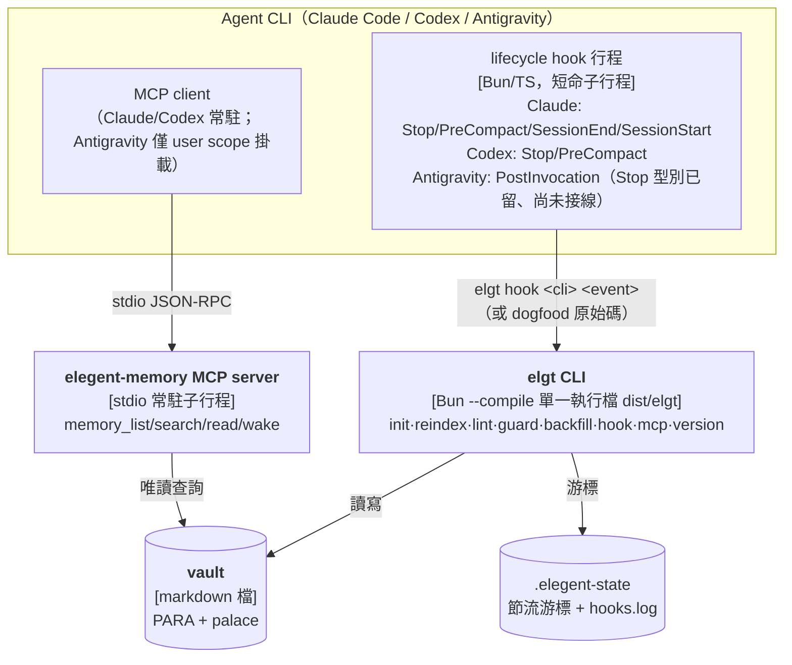
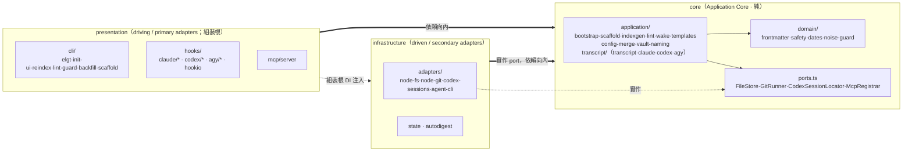
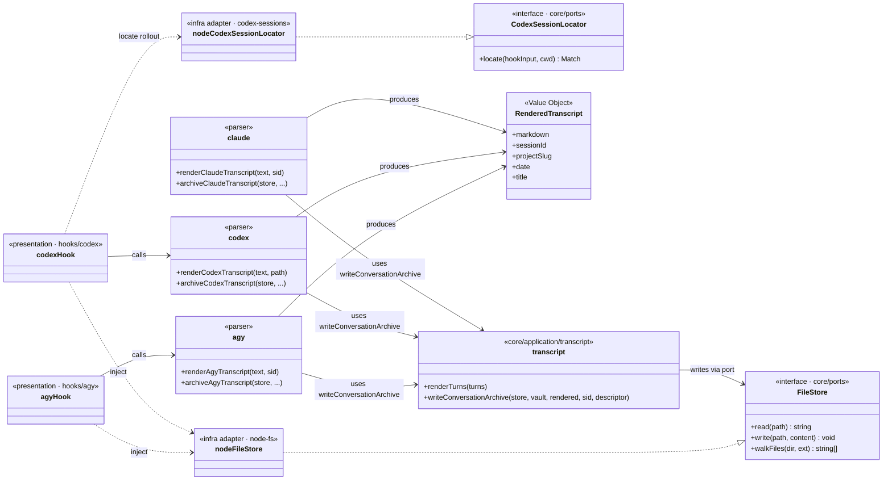

# EleGent 架構 — C4 模型

> C4 的四個縮放層級（Context → Container → Component → Code），一層一張圖，各回答不同受眾的問題。決策的「為什麼」不在此，見 [`docs/adr/`](../adr/)。
>
> 一句話定位：EleGent（`elgt`）在使用者資料夾建立**雙受眾 markdown vault**（PARA 給人、記憶宮殿給 LLM），並整合各家 agent CLI 的 lifecycle hooks + MCP，自動把對話逐字稿歸檔進 vault、對外供記憶查詢。**這個 repo 是「產生 vault 的工具原始碼」，不是活的 vault。**

---

## L1 — System Context

**受眾：** 想知道「這是什麼、跟誰互動」的人。

`elgt init` 不再往使用者 vault 寫 `CLAUDE.md`/`AGENTS.md`：agent 行為改由 digest skill（寫入/策展）+ MCP server（查詢/定位）承載，三個 agent CLI（Claude Code、Codex、Antigravity）依各自 scope（`project`/`user`/`local`/`none`）取得對應的 hooks 設定與 digest skill；MCP 註冊 Claude/Codex 走各自官方 CLI 的 `mcp add`，Antigravity 無此 CLI，僅 user scope 直接合併寫入 `mcp_config.json`。

---

## L2 — Container

**受眾：** 工程師 / 維運——「有哪些可執行單元、用什麼技術、怎麼溝通」。

`elgt` 與 MCP server 是同一份程式碼（`elgt mcp` 啟動 MCP）；hook 行程亦呼叫 `elgt`（或 dogfood 時直接跑原始碼）。無網路服務、無 DB。

---

## L3 — Component（`elgt` app 內部）

**受眾：** 在 repo 內開發的人。三區塊 Explicit Architecture，依賴一律向內。

主要 runtime 相依：`ink`/`react`/`@inkjs/ui` 支撐互動式 `init` TUI；`@modelcontextprotocol/sdk` + `zod` 支撐 MCP server 與 tool schema；`yaml` 支撐 markdown frontmatter parse/stringify。

依賴規則由 [`src/architecture.test.ts`](../../src/architecture.test.ts) 在 CI 強制（見 [dependencies.md](./dependencies.md)）。

---

## L4 — Code（逐字稿歸檔管線 · class 層）

**受眾：** 想看某個 component 真實類別結構的工程師。挑「對話歸檔」這條核心管線。

Core（`transcript`/`claude`/`codex`/`agy`）只依賴 `FileStore` 等 port 介面；Codex rollout 的定位由 presentation 的 `codexHook` 呼叫 `CodexSessionLocator` adapter 後，再把找到的檔案內容交給 core parser（`agyHook` 不需要定位——transcript path 直接來自 hook 輸入）。具體 `node-*` adapter 由 presentation 的 hook 組裝根注入——這就是 Ports & Adapters 在型別層的樣子（詳見 [uml.md](./uml.md) 的 pattern 圖）。
