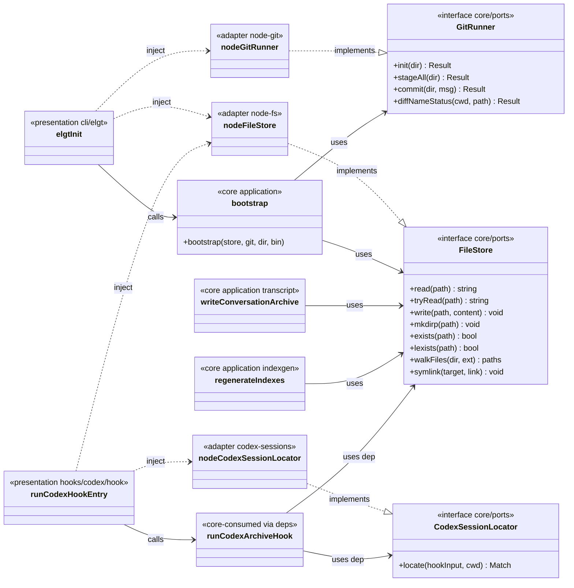
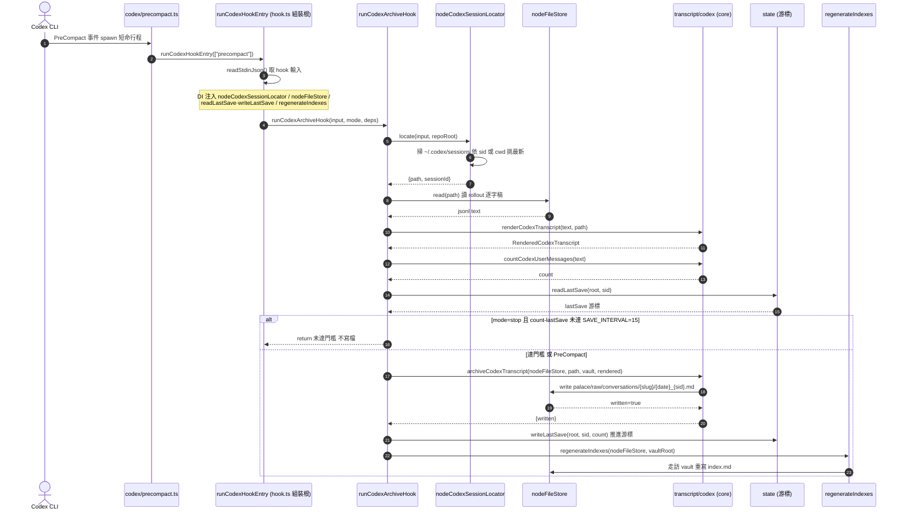
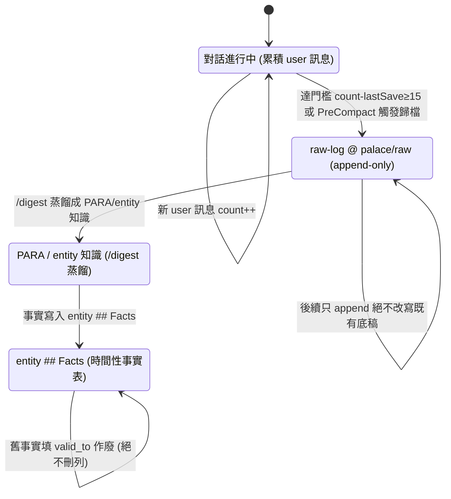
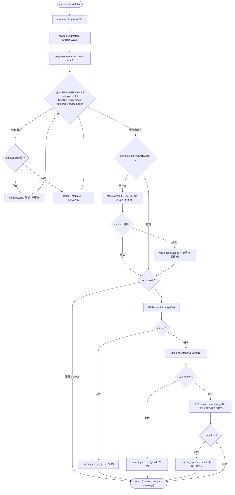

# EleGent 架構 UML（四張聚焦圖）

> 四張 UML 各回答「一個問題」，對應 4+1 view model：Pattern class（development / 靜態結構）、Sequence（process / 執行期互動）、State machine（logical / 一段記憶的生命週期）、Activity（process / init 分支流程）。全部只描繪《架構共享模型》既有元件，不新增、不改名。
>
> 依賴方向恆為 `presentation → core ← infrastructure`；`src/architecture.test.ts` 以 CI 強制，違反即 build fail。

---

## 1. Pattern classDiagram — Ports & Adapters（Hexagonal）

**問題**：Core 怎麼在「不碰 `node:fs`／`Bun.spawn`」的前提下做 I/O？**受眾**：工程師。
**要點**：Core 擁有三個 port（`FileStore`／`GitRunner`／`CodexSessionLocator`），Infrastructure 提供唯一的 secondary/driven 實作（`..|>`），Core application 只依賴介面（`-->` uses），由 presentation 的兩個組裝根以 DI 注入具體 adapter（`..>` inject）。

實線 `-->`（uses）永遠指向 Core 的 port，具體 `node-*` adapter 只被 presentation 組裝根用 `..>`（inject）接進去——這就是「依賴向內、實作向外」在型別層的樣子。

---

## 2. Sequence — Codex PreCompact／Stop hook 歸檔一次互動

**問題**：一次 hook 事件如何把 Codex 逐字稿落進 `palace/raw`？**受眾**：工程師（process view）。
**要點**：`runCodexHookEntry` 是這條路徑的**組裝根**，讀完 stdin 後把 `nodeCodexSessionLocator`／`nodeFileStore`／`readLastSave·writeLastSave`／`regenerateIndexes` 注進 `runCodexArchiveHook`；節流門檻 `SAVE_INTERVAL=15` 只在 `stop` 模式擋，PreCompact 一律歸檔。

註：依共享模型，逐字稿的讀取畫成 `FileStore.read`（薄檔案系統 port）；寫檔一律經 `FileStore.write`，Core 全程不碰具體 I/O。

---

## 3. State machine — 一段記憶的生命週期

**問題**：一則對話從「進行中」到「被作廢的舊事實」經過哪些狀態？**受眾**：工程師（logical view）。
**要點**：`palace/raw` 是 append-only 的原始底稿（`raw-log`），`/digest` 才把它蒸餾成 PARA/entity 知識；entity 的 `## Facts` 用 `valid_to` 作廢舊事實而非刪列——時間性事實只增不減。

`Raw` 與 `Facts` 兩個自迴圈是本系統的核心不變式：**底稿只 append、事實只作廢**——`elgt lint`／`guard` 以 git diff 對 `palace/raw` 強制 append-only（UC7／UC8）。

---

## 4. Activity（flowchart）— `elgt init` bootstrap 分支流程

**問題**：`elgt init` 一鍵初始化時，哪些步驟會分支、哪些失敗只警告不中斷？**受眾**：工程師（process view）。
**要點**：模板逐檔冪等（存在則略過、絕不覆寫）；`AGENTS.md` symlink 失敗只警告；只有「非 git repo」才跑 `init → stageAll → commit`，且三步任一失敗都只 `warnings.push` 後照常回傳。

全流程冪等：對同一 `targetDir` 重跑，第二次 `created` 為空、既有檔內容不變；git 三步的錯誤全數收斂成 `warnings`，UC1 保證 init 不因環境（無 git identity、fs 不支援 symlink）而 throw。

---

### 檔案錨點（供維護時對照程式碼）

- Port 定義：`src/core/ports.ts`（`FileStore` / `GitRunner` / `CodexSessionLocator`）
- Adapter 實作：`src/infrastructure/adapters/{node-fs,node-git,codex-sessions}.ts`
- Codex hook 組裝根與用例：`src/presentation/hooks/codex/hook.ts`（`runCodexHookEntry` / `runCodexArchiveHook`）、進入點 `src/presentation/hooks/codex/precompact.ts`
- 歸檔核心：`src/core/application/transcript/{transcript,codex}.ts`（`writeConversationArchive` / `renderCodexTranscript` / `countCodexUserMessages` / `archiveCodexTranscript`）
- init 用例：`src/core/application/bootstrap.ts`；CLI 組裝根 `src/presentation/cli/elgt.ts`
- 依賴規則 CI 強制：`src/architecture.test.ts`
