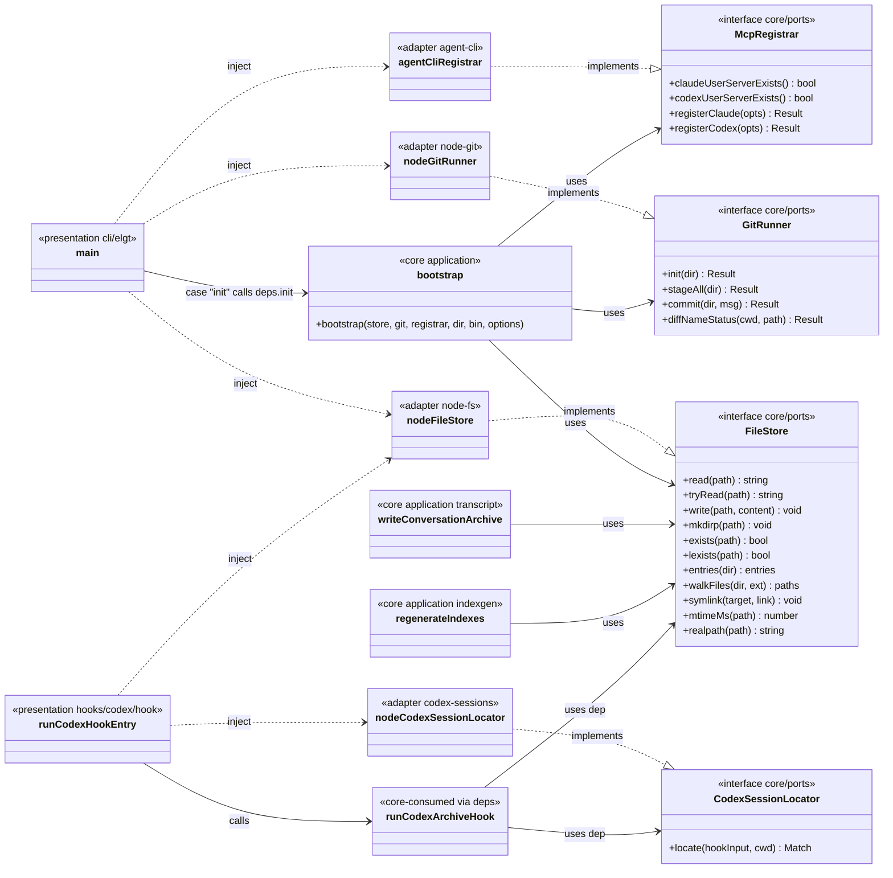
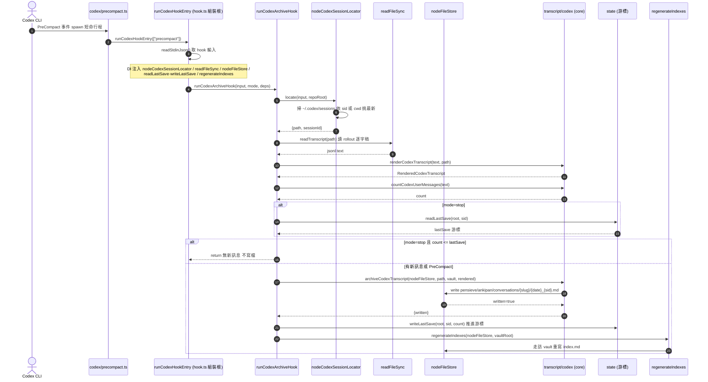
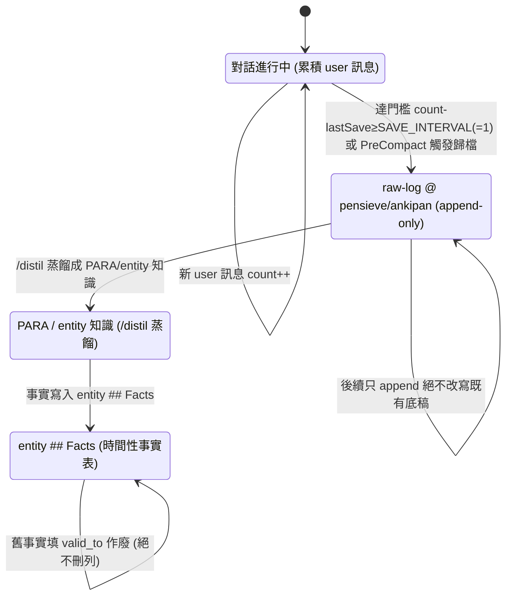

# EleGent 架構 UML（四張聚焦圖）

> 四張 UML 各回答「一個問題」，對應 4+1 view model：Pattern class（development / 靜態結構）、Sequence（process / 執行期互動）、State machine（logical / 一段記憶的生命週期）、Activity（process / init 分支流程）。全部只描繪《架構共享模型》既有元件，不新增、不改名。
>
> 依賴方向恆為 `presentation → core ← infrastructure`；`src/architecture.test.ts` 以 CI 強制，違反即 build fail。

---

## 1. Pattern classDiagram — Ports & Adapters（Hexagonal）

**問題**：Core 怎麼在「不碰 `node:fs`／`Bun.spawn`」的前提下做 I/O？**受眾**：工程師。
**要點**：Core 擁有三個 port（`FileStore`／`GitRunner`／`CodexSessionLocator`），Infrastructure 提供唯一的 secondary/driven 實作（`..|>`），Core application 只依賴介面（`-->` uses），由 presentation 的兩個組裝根以 DI 注入具體 adapter（`..>` inject）。

實線 `-->`（uses）永遠指向 Core 的 port，具體 `node-*` adapter 只被 presentation 組裝根用 `..>`（inject）接進去——這就是「依賴向內、實作向外」在型別層的樣子。

---

## 2. Sequence — Codex PreCompact／Stop hook 歸檔一次互動

**問題**：一次 hook 事件如何把 Codex 逐字稿落進 `pensieve/ankipan`？**受眾**：工程師（process view）。
**要點**：`runCodexHookEntry` 是這條路徑的**組裝根**，讀完 stdin 後把 `nodeCodexSessionLocator`／`readFileSync`／`nodeFileStore`／`readLastSave·writeLastSave`／`regenerateIndexes` 注進 `runCodexArchiveHook`。Codex 沒有 `SAVE_INTERVAL` 常數節流；只有 `stop` 模式在 `count <= lastSave`（完全沒有新 user 訊息）時略過，PreCompact 一律歸檔（Claude Stop 目前也是 `SAVE_INTERVAL=1`，效果上同樣是「有新訊息就寫」，差別只在 Codex 用 `<=` 判斷、Claude 用 `count - lastSave < SAVE_INTERVAL` 判斷）。`readLastSave` 因 `&&` 短路只會在 stop 模式呼叫。

註：Codex hook 的 rollout 讀取目前在 presentation 組裝根用 `readFileSync` 實作為 `readTranscript` dep；寫檔一律經 `archiveCodexTranscript(nodeFileStore, ...)` 進入 Core 的 `FileStore.write`，Core 全程不碰具體 I/O。

---

## 3. State machine — 一段記憶的生命週期

**問題**：一則對話從「進行中」到「被作廢的舊事實」經過哪些狀態？**受眾**：工程師（logical view）。
**要點**：`pensieve/ankipan` 是 append-only 的原始底稿（`raw-log`），`/distil` 才把它蒸餾成 PARA/entity 知識；entity 的 `## Facts` 用 `valid_to` 作廢舊事實而非刪列——時間性事實只增不減。

`Ankipan` 與 `Facts` 兩個自迴圈是本系統的核心不變式：**底稿只 append、事實只作廢**。`elgt lint` 以 git diff 對 `pensieve/ankipan` 強制 append-only（UC7）；`elgt guard <file>` 則針對任意既有檔案檢查既有 `##` heading 不可消失、`## Citations` 條目只增不減、`user_managed: true` 不可被改動（UC8）。

---

## 4. Activity（flowchart）— `elgt init` bootstrap 分支流程

**問題**：`elgt init` 一鍵初始化時，哪些步驟會分支、哪些失敗只警告不中斷？**受眾**：工程師（process view）。
**要點**：`elgt init` 不再產生 `CLAUDE.md`/`AGENTS.md`/`.mcp.json`——agent 行為改由「distil skill（逐 agent scope 冪等寫入，skip-if-exists）+ hooks 設定（`config-merge.ts` 逐 agent 冪等合併，非 skip-if-exists）+ MCP 註冊（`McpRegistrar`，Claude/Codex 走官方 CLI、Codex project/local 因 CLI 無 scope flag 改直寫 `.codex/config.toml`、Antigravity 只有 user scope 直接合併 `mcp_config.json`）」三條腿承載；vault 位置由 `claude/codex/agyScope` 三者共同推導（任一 `local`→隱藏嵌入、任一 `project`→可見嵌入、否則獨立命名）；hooks/skill/MCP 註冊逐一失敗都只 `warnings.push`，不中斷整個 init；只有「非 git repo」才跑 `init → stageAll → commit`，三步任一失敗同樣只警告。

```mermaid
flowchart TD
    A(["elgt init &lt;targetDir&gt;<br/>claude/codex/agyScope 各自 project|user|local|none（預設 user）"]) --> V{"assertScopeCompatible：<br/>local 與 project/user 混用？"}
    V -->|是| ERR(["throw，exit 非零"])
    V -->|否| MODE["deriveVaultMode + vaultDirName + resolveVaultDir<br/>（local/project → basename slug 強制命名；user → vaultName 或 'vault'）"]
    MODE --> MK["store.mkdirp(targetDir) → scaffoldVault(store, vaultDir)（冪等）→ regenerateIndexes"]

    MK --> SKILL{"逐 agent（claude/codex/agy）<br/>scope!==none 且 skill 已存在？"}
    SKILL -->|存在| SKSK["skipped.push（略過，不覆寫）"] --> SKILL
    SKILL -->|不存在| SKWR["renderTemplate('skill-distil') + store.write"] --> SKILL
    SKILL -->|三個 agent 都處理完| HOOK

    HOOK["hookCommand = ELEGENT_ROOT=&lt;targetDir&gt; ELEGENT_VAULT_NAME=&lt;vaultName&gt; elegentBin<br/>（user/project/local 皆用此絕對形式，避免 hook 執行時讀錯 vault）"] --> MERGE{"逐 agent scope!==none：<br/>mergeClaudeSettings / mergeCodexHooks / mergeAgyHooks"}
    MERGE -->|merge 成功| MOK["store.write；僅 existing===null 才算 created"] --> MERGE
    MERGE -->|既有檔 parse 失敗| MFAIL["warnings.push（保留原檔，不中斷）"] --> MERGE
    MERGE -->|三個 agent 都處理完| GI2{"mode === 'local' ?"}

    GI2 -->|是| GITIGNORE["ensureGitignoreLine：vault 目錄名加進 .gitignore"] --> MCPC
    GI2 -->|否| MCPC

    MCPC{"claudeScope !== none ?"}
    MCPC -->|是| CSKIP{"(scope===local 或 project)<br/>且 claudeUserServerExists() ?"}
    CSKIP -->|是，跳過（避免蓋掉 user 層）| CXC
    CSKIP -->|否| CREG["registerClaude(scope, vaultDir)<br/>失敗只 warnings.push"] --> CXC
    MCPC -->|否| CXC

    CXC{"codexScope !== none ?"}
    CXC -->|user| CDXU["registerCodex(scope=user)<br/>失敗只 warnings.push"] --> AGC
    CXC -->|project/local| CDXPL{"codexUserServerExists() ?"}
    CDXPL -->|是，跳過| AGC
    CDXPL -->|否| CDXTOML["appendCodexMcpToml：直寫 .codex/config.toml<br/>（codex CLI 無 project/local scope flag）"] --> AGC
    CXC -->|none| AGC

    AGC{"agyScope === 'user' ?"}
    AGC -->|是| AGCW["mergeAgyMcpConfig → 寫 mcp_config.json<br/>（agy 無 mcp add CLI；project/local 不寫 MCP，僅 hooks/skill）"] --> GITSTEP
    AGC -->|否| GITSTEP

    GITSTEP{".git 已存在 ?"}
    GITSTEP -->|已是 git repo| DONE(["return {created, skipped, warnings}"])
    GITSTEP -->|否| GI["GitRunner.init(targetDir)"]
    GI --> GIOK{"init ok ?"}
    GIOK -->|失敗| GIW["warnings.push (git init 失敗)"] --> DONE
    GIOK -->|成功| GA["GitRunner.stageAll(targetDir)"]
    GA --> GAOK{"stageAll ok ?"}
    GAOK -->|失敗| GAW["warnings.push (git add 失敗)"] --> DONE
    GAOK -->|成功| GC["GitRunner.commit(targetDir, 'init: EleGent 記憶系統初始化')"]
    GC --> GCOK{"commit ok ?"}
    GCOK -->|失敗| GCW["warnings.push (commit 失敗只警告，通常是 git identity 未設定)"] --> DONE
    GCOK -->|成功| DONE
```

全流程冪等：對同一 `targetDir` 重跑，第二次 `created` 為空、既有檔內容不變；git 三步的錯誤全數收斂成 `warnings`，UC1 保證 init 不因環境（無 git identity、fs 不支援 symlink）而 throw。

---

### 檔案錨點（供維護時對照程式碼）

- Port 定義：`src/core/ports.ts`（`FileStore` / `GitRunner` / `CodexSessionLocator`）
- Adapter 實作：`src/infrastructure/adapters/{node-fs,node-git,codex-sessions}.ts`
- Codex hook 組裝根與用例：`src/presentation/hooks/codex/hook.ts`（`runCodexHookEntry` / `runCodexArchiveHook`）、進入點 `src/presentation/hooks/codex/precompact.ts`
- 歸檔核心：`src/core/application/transcript/{transcript,codex}.ts`（`writeConversationArchive` / `renderCodexTranscript` / `countCodexUserMessages` / `archiveCodexTranscript`）
- init 用例：`src/core/application/bootstrap.ts`；CLI 組裝根 `src/presentation/cli/elgt.ts`
- 依賴規則 CI 強制：`src/architecture.test.ts`
